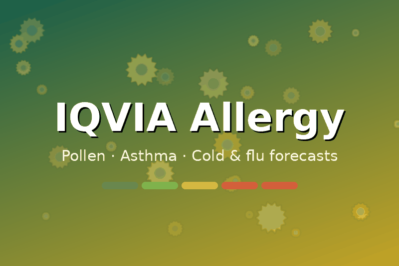

# IQVIA Allergy for Gladys Assistant

External integration for [Gladys Assistant](https://gladysassistant.com) that
brings the **IQVIA** allergy (pollen), asthma and cold & flu forecasts of
your US ZIP codes into Gladys — as devices, scene triggers and actions, and a
dashboard widget. Built with the JavaScript SDK
[`@gladysassistant/integration-sdk`](https://github.com/GladysAssistant/integration-sdk-js),
from the official
[integration template](https://github.com/GladysAssistant/integration-template-js).



User documentation: [English](docs/en.md) · [Français](docs/fr.md) ·
[Deutsch](docs/de.md) · [Español](docs/es.md)

## Features

| Surface         | What it does                                                                                                                                     |
| --------------- | ------------------------------------------------------------------------------------------------------------------------------------------------ |
| Devices         | per ZIP code: **pollen**, **asthma** and **cold & flu** forecasts (index 0–12 today and tomorrow, allergens / triggers, pollen season and trend) |
| Transport badge | `cloud`, or `unreachable` when the last read failed (manifest `"transports": ["cloud"]`)                                                         |
| Actions         | **Test the connection**, **Refresh the forecasts** (Configuration screen)                                                                        |
| Scene triggers  | `level_changed` (today's level moved to another band), `forecast_updated` (new daily forecast)                                                   |
| Scene actions   | `get_forecast` (index, level, translated label, triggers, location), `refresh_forecasts`                                                         |
| Widget          | `allergy_forecast`: live indexes, next days chart, levels, allergens, refresh button                                                             |
| Languages       | English, French, German, Spanish                                                                                                                 |

IQVIA sells no connected device: the "devices" are the read-only forecasts of
a location. The data comes from IQVIA's public websites (pollen.com,
asthmaforecast.com, flustar.com) — no account, no API key — through the same
endpoints as the open-source [`pyiqvia`](https://github.com/bachya/pyiqvia)
library used by Home Assistant. This project is not affiliated with IQVIA.

Requires **Gladys 5.1.0 or later** (scene triggers, scene actions and
widgets).

## Configuration

| Key              | Type   | Default | Description                                                   |
| ---------------- | ------ | ------- | ------------------------------------------------------------- |
| `zip_codes`      | string | —       | 1 to 5 US ZIP codes (5 digits), separated by commas           |
| `poll_frequency` | number | `3600`  | Seconds between two reads (900 to 86400); IQVIA updates daily |

## Project structure

```
.
├─ index.js                     # SDK bootstrap + event wiring
├─ src/
│  ├─ iqvia.js                  # IQVIA client (endpoints, retries, parsers)
│  ├─ devices/                  # forecast devices, registry, scene triggers
│  ├─ actions.js                # Configuration screen buttons
│  ├─ scenes.js                 # scene actions
│  ├─ widgets.js                # dashboard widget
│  ├─ i18n.js                   # levels + en/fr/de/es texts
│  └─ config.js                 # config defaults + ZIP code parsing
├─ docs/{en,fr,de,es}.md        # user documentation (re-hosted by Gladys)
├─ test/                        # node --test, fake Gladys + fake IQVIA
├─ gladys-assistant-integration.json
├─ Dockerfile                   # Node 24 Alpine, read-only rootfs ready
├─ CHANGELOG.md · CLAUDE.md · SECURITY.md
└─ .github/                     # CI, release, build, GitHub releases, Dependabot
```

## Development

```bash
npm install
npm run format:check
npm run lint
npm test
```

Run it against a Gladys instance:

```bash
GLADYS_HOST_API_URL="http://localhost:1443" \
GLADYS_INTEGRATION_TOKEN="<token>" \
GLADYS_INTEGRATION_SELECTOR="iqvia-allergy" \
LOG_LEVEL=debug \
npm start
```

The three `GLADYS_*` variables are injected by the Gladys supervisor when the
integration runs inside its sandboxed container.

## Release

Describe the changes under `## [Unreleased]` in [`CHANGELOG.md`](CHANGELOG.md),
then open **Actions → Release → Run workflow** and pick `patch`, `minor` or
`major`. The workflow bumps the version (`package.json`, manifest `version`
and `docker_image`), rolls the changelog, pushes the `vX.Y.Z` tag, builds the
`linux/amd64` + `linux/arm64` image to `ghcr.io/gboulvin/gladys-iqvia-allergy`
and publishes the GitHub Release.

To be listed in the Gladys integration store, the repository must be public
and carry the GitHub topic `gladys-assistant-integration`.

## License

Apache-2.0
